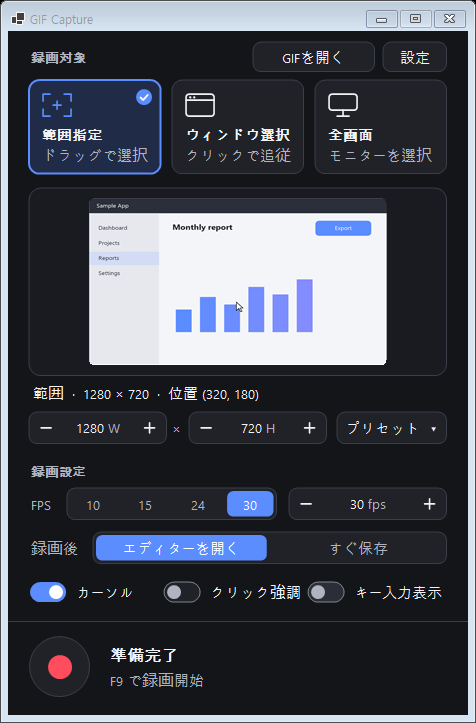

<p align="center">
  
</p>

<h1 align="center">GIF Capture</h1>

<p align="center">
  画面の好きな範囲を録画し、編集して、軽いGIFとして保存。すべての処理は自分のPCの中だけで完結します。<br>
  <a href="README.md">English</a> · <a href="README.ko.md">한국어</a> · <b>日本語</b>
</p>

<p align="center">
  
</p>

GIF Capture は、画面を録画してGIFにする軽量な Windows アプリです。チームにバグを見せる、ドキュメント用の短い操作説明を作る、
ゲームの一場面を共有する、といった日常的な用途に合わせて作られています。範囲を選んで **F9**、もう一度 **F9** を押せばGIFの
完成です。必要ならエディターでトリミングやテキストの追加、容量の調整をしてから保存できます。

アカウント登録、アップロード、クラウドはありません。録画した画面とGIFはこのPCにのみ保存されます。

## ダウンロード

**[⬇ GifCapture.exe をダウンロード（最新版）](https://github.com/dnwls010728/GIFCapture/releases/latest/download/GifCapture.exe)**

Windows 10 2004 以降 / Windows 11（64ビット）向けの単一実行ファイルです。インストールも .NET のインストールも不要で、そのまま実行できます。
初回起動時に Windows SmartScreen の警告が出た場合は **詳細情報 → 実行** を選んでください。
すべてのバージョンは [Releases](https://github.com/dnwls010728/GIFCapture/releases) ページにあります。

## 機能

**録画**
- 録画対象は3通り：**範囲**をドラッグ、**ウィンドウ**をクリック（ウィンドウを動かすと範囲も追従）、**モニター**全体
- 画面上に青い枠が表示され、ドラッグで位置とサイズを調整できます。拡大鏡と端へのスナップでピクセル単位まで合わせられます
- 幅・高さの数値入力、**サイズプリセット**（360p、720p、1080p、正方形、縦長など）とマイプリセットの保存
- 1〜60 FPS、マウスカーソル表示、説明用の **クリック強調** と **キー入力表示**
- 3秒カウントダウン、グローバルショートカット **F9**。アプリ自身のウィンドウは録画に映りません

**編集**
- サムネイル付きタイムライン、再生、複数選択（Shift / Ctrl / ドラッグ）
- 削除、選択のみ残す、**前後のトリミング**、複製、逆再生、往復再生
- フレームごとの表示時間、2倍速く / 遅く
- トリミング、90° 回転、左右反転（字幕は装飾タブのテキストで入れます）
- プレビューの拡大・移動、すべての操作の元に戻す / やり直し

**装飾**
- すべてのフレームに **透かし**：テキスト（インストール済みの任意のフォントとスタイル、色、サイズ、不透明度、読みやすさのための暗い縁取りを選択可）または透過PNGロゴなどの画像
- 9分割の位置グリッドで配置するか、プレビュー上でドラッグして移動し、角のハンドルでサイズ変更
- 透かしの設定は次回も記憶され、**すぐ保存** にも適用されます
- 特定のフレームに **画像（ステッカー）を挿入**：タイムラインで選んだフレームに、ボタン、**Ctrl+V** 貼り付け、または画像ファイルをプレビューへドラッグ＆ドロップで追加。プレビュー上のドラッグで移動・サイズ変更、画像ごとの不透明度、選択したフレームにも表示 / 選択したフレームから削除、**Del** で削除
- 挿入した画像は **回転** できます：プレビューで選択中の画像の上にある丸いハンドルをドラッグ（**Shift** で15°単位）するか、**回転** スライダーを使います。サイズ変更は画像の中心を基準に拡大縮小されます
- **テキスト · 画像 · モザイク** セクション：インストール済みの任意のフォント、色、サイズの **テキスト** を追加でき、暗い背景ボックス（字幕風）や縁取りも選べます。画像と同様にプレビューで移動・サイズ変更・回転でき（**Shift** で15°単位）、テキストはダブルクリックで編集できます。テキスト欄で **Enter** を押すと、入力したテキストが選択したフレームの下部に入ります。直前のテキストスタイルは記憶されます
- **字幕はテキスト項目になりました**：「テキストを追加」は既定で下部中央に暗い背景ボックス付きで入り、従来の字幕と同じ見た目ですが、移動・サイズ変更・回転・スタイル変更ができます
- **モザイク**：選んだフレームの一部をピクセル化して個人情報を隠します。ドラッグで移動、角のハンドルで形（縦横比は自由）を変更、回転も可能で、**マスの大きさ** スライダー（1〜10）で粗さを決めます。モザイクは録画された画面だけを隠すため、その上に置いたテキストや画像は鮮明なままです
- 項目（テキスト、画像、モザイク）は選択したフレームにも表示 / 選択したフレームから削除でき、不透明度と角度のスライダーがあり、**Del** で選んだ項目を削除します
- 項目のあるフレームにはタイムラインに小さなバッジ（**T** テキスト、**▣** 画像、**▦** モザイク）が表示され、すべて元に戻せます

**書き出し**
- 用途別プリセット：**資料**、**SNS**（横 1280px 以下）、**ゲーム**（高画質・30fps）
- 画質、画像サイズ、最大FPS、似たフレームをまとめる、ループ回数（無限または N 回）
- **拡大書き出し**: 画像サイズを最大600%まで、×2〜×6 の倍率ボタンまたはスライダーで自由に。拡大方法は **四角**（くっきりしたブロック）、**滑らか**（バイキュービック）、**鮮明**（Lanczos 補間＋シャープ化、画面録画や文字に最適）、**ドット**（xBR でドット絵の斜線や曲線を滑らかに）から選べ、プレビューに結果がそのまま表示されます
- **予想ファイルサイズをリアルタイム表示**、目標容量（例：15MB）に **自動で合わせる**
- フレームごとに変化した部分だけを保存し、各フレームのカラーテーブルを実際に使う色数に合わせて小さくするため、ファイルが小さくなります
- 高速な書き出し：エンコード中に複数のCPUコアでフレームを描画し、保存中に保存ボタンをもう一度押すと **キャンセル** できます
- フォルダーへすぐ保存、ファイルをクリップボードにコピーしてチャットに **Ctrl+V**、ゲームエンジン向けの **PNG連番**（表示時間のCSV付き）
- 既存のGIFを開いて編集（ボタン、Ctrl+O、ドラッグ＆ドロップ）

**アップデート**
- **自動アップデート確認**：起動時にGitHub Releasesを確認します。新しいバージョンがあるとリリースノートを表示するダイアログが開き、ダウンロード、SHA-256の検証、exeの入れ替え、再起動まで行えます（フォルダーに書き込めない場合はリリースページを開きます）。**このバージョンをスキップ** と **後で** も選べます
- **設定 → アップデート** でオフにでき、**今すぐ確認** もあります

**画面表示** は日本語・英語・韓国語に対応し、読みやすさを重視した高コントラストのダークテーマです。長いラベルは枠に合わせて縮小され、小さな画面でもエディターが収まるようサイドバーがスクロールします。

## スクリーンショット

| メイン画面 | エディター |
|---|---|
|  |  |

| 書き出し設定 | 設定 |
|---|---|
|  |  |

エディターのスクリーンショットは英語表示です。言語は設定から変更できます。

## はじめに

### 動作環境
- Windows 10 バージョン 2004 以降（Windows 11 推奨）、64ビット

### ビルドと実行
GIF Capture は外部ライブラリを使わない .NET 10 WinForms アプリです。

```powershell
git clone https://github.com/dnwls010728/GIFCapture.git
cd GIFCapture
dotnet run -c Release
```

.NET をインストールせずに動く単一の `GifCapture.exe` を作るには：

```powershell
dotnet publish -c Release -o publish
```

`publish\GifCapture.exe` を好きな場所にコピーして実行してください。設定は `%AppData%\GifCapture` に保存されます。

## 使い方

### 1. 録画対象を選ぶ
メイン画面の3つのカードから1つをクリックします。

- **範囲指定** — 静止した画面上で四角形をドラッグ
- **ウィンドウ選択** — ウィンドウにマウスを乗せてクリック
- **全画面** — モニターをクリック

**プリセット** からサイズを選ぶと、そのサイズの範囲が画面中央にすぐ作られます。

### 2. 範囲を調整する
範囲の周りに青い枠が表示されます。枠や角のハンドルをドラッグするとサイズが、上部のサイズタブをドラッグすると位置が変わります。
ドラッグ中は拡大鏡が端の下のピクセルを拡大表示します。枠の内側はクリックがそのまま通るので、下のアプリを使い続けられます。
メイン画面で幅と高さを数値で入力することもできます。

### 3. 録画する
赤いボタンか **F9** を押します。3秒のカウントダウンのあと枠が赤くなり、経過時間が表示されます。
もう一度 **F9** を押すと停止します。

録画前に選べる項目：
- **FPS** — 通常は 10〜30 で十分です
- **録画後** — *エディターを開く*（先に確認）または *すぐ保存*（前回の書き出し設定ですぐ保存）
- **カーソル**、**クリック強調**、**キー入力表示** — パスワード入力時は *キー入力表示* をオフにしてください

### 4. 編集する（任意）
エディターが開くと、すべてのフレームがタイムラインに並びます。クリック、Shift+クリック、ドラッグでフレームを選び、
**編集** タブでトリミング、削除、表示時間の変更、切り抜き、回転を行います。すべての操作は **Ctrl+Z** で元に戻せます。

**装飾** タブでは、すべてのフレームにテキストや画像の **透かし** を入れたり、選んだフレームにテキスト（字幕を含む）・画像・モザイクを追加したりできます
（ボタン、**Enter**、**Ctrl+V**、または画像ファイルをプレビューへドロップ）。プレビュー上で項目や透かしをドラッグして移動し、
角のハンドルでサイズを変えます。

### 5. 書き出す
**書き出し** タブで用途別プリセットを選ぶか、画質・サイズ・FPS を自分で設定します。サイズを100%より大きくすると拡大され
（**×2〜×6** ボタン）、**四角 / 滑らか / 鮮明 / ドット** から拡大方法を選べます。設定を変えるたびに予想サイズが更新されます。
**目標容量** を入力して **容量に合わせる** を押すと、その容量に収まる設定を探します。ファイル名を決めて **GIFを保存**
（**Ctrl+S**）を押してください。保存したファイルはクリップボードにもコピーされ、チャットにそのまま貼り付けられます。保存中にボタンをもう一度押すとキャンセルできます。

## ショートカット

| 場所 | キー | 操作 |
|---|---|---|
| どこでも | F9 | 録画開始 / 停止 |
| メイン画面 | Ctrl+O | GIFを開く |
| カウントダウン | Esc | キャンセル |
| エディター | Space | 再生 / 一時停止 |
| エディター | ← →（Shift） | 前 / 次のフレーム（選択を拡張） |
| エディター | Home / End | 最初 / 最後のフレーム |
| エディター | Ctrl+A / Esc | すべて選択 / 選択解除 |
| エディター | Del / Ctrl+D | フレームの削除 / 複製（プレビューで項目を選択中は Del でその項目を削除） |
| エディター | Ctrl+V | クリップボードの画像を貼り付け |
| エディター | Ctrl+Z / Ctrl+Y | 元に戻す / やり直し |
| エディター | ホイール、Ctrl+0、Ctrl+1 | 拡大/縮小、フィット、100% |
| エディター | Ctrl+S / Ctrl+Shift+C | 保存 / 保存したファイルをコピー |

## プライバシー

GIF Capture は録画やその他のデータをアップロード・同期・送信しません。アプリが行うネットワーク通信は、GitHub Releasesでの新バージョン確認だけで、設定 → アップデート でオフにできます。*キー入力表示* は録画中にのみ
キーボードフックを使い、押したキーを自分のGIFに描画するためだけに使用します。

## プロジェクト構成

| ファイル | 役割 |
|---|---|
| `MainForm.cs` | メイン画面：対象の選択、プリセット、録画の流れ |
| `RegionSelector.cs`, `RegionFrame.cs`, `Loupe.cs` | 範囲 / ウィンドウ / モニターの選択、画面上の枠、拡大鏡 |
| `Recorder.cs`, `ScreenGrabber.cs`, `InputOverlay.cs` | キャプチャーループ、GDI による画面コピー、クリック・キー表示 |
| `FrameStore.cs` | 圧縮した一時フレームの保存 |
| `EditorForm.cs`, `EditorCanvas.cs`, `Timeline.cs` | エディター画面、プレビュー、タイムライン |
| `GifEncoder.cs`, `GifExporter.cs` | GIFエンコーダー（median-cut パレット、LZW、変化範囲のみ保存）、書き出し、GIF読み込み |
| `Strings*.cs` | 画面テキスト：韓国語（原文）、英語、日本語 |

## ライセンス

[MIT](LICENSE)
