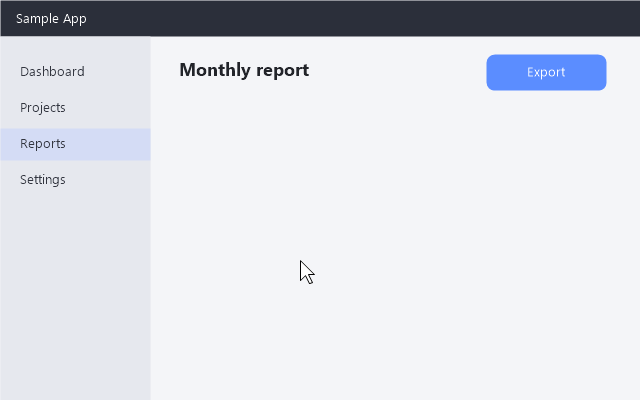
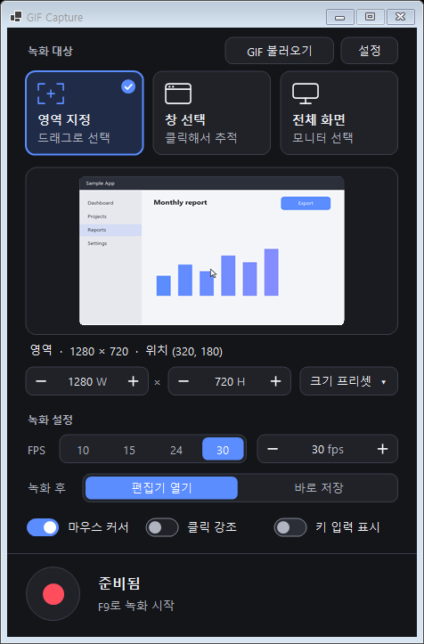
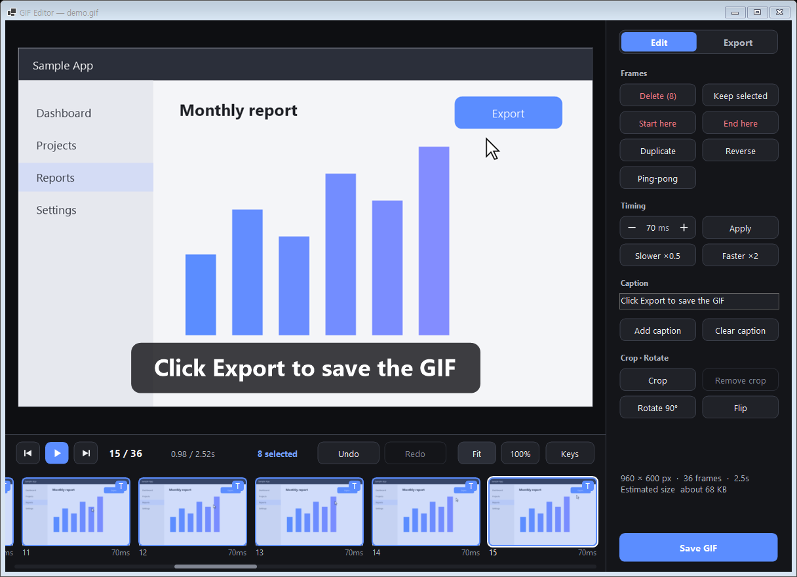
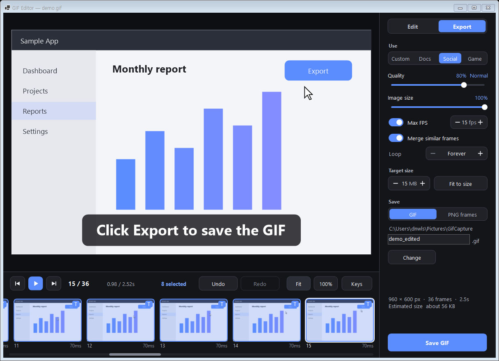
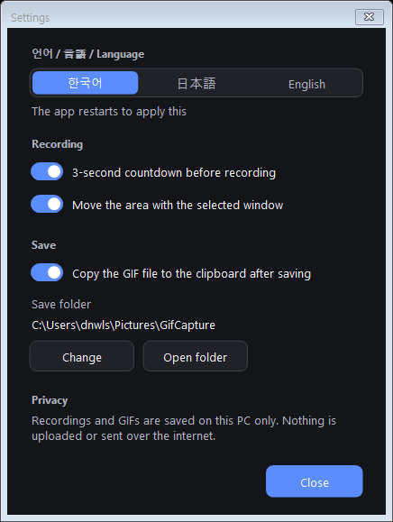

<p align="center">
  
</p>

<h1 align="center">GIF Capture</h1>

<p align="center">
  화면의 원하는 부분을 녹화하고, 다듬고, 작은 GIF로 저장합니다. 모든 작업은 내 PC 안에서만 이뤄집니다.<br>
  <a href="README.md">English</a> · <b>한국어</b> · <a href="README.ja.md">日本語</a>
</p>

<p align="center">
  
</p>

GIF Capture는 화면을 녹화해 GIF로 만드는 가벼운 Windows 프로그램입니다. 동료에게 버그를 보여줄 때, 문서에 넣을 짧은
사용법을 만들 때, 게임 장면을 공유할 때처럼 일상적인 상황에 맞춰 만들었습니다. 영역을 고르고 **F9**, 다시 **F9**를 누르면
GIF가 완성됩니다. 필요하면 편집기에서 자르고, 자막을 넣고, 용량을 줄인 뒤 저장할 수 있습니다.

계정도, 업로드도, 클라우드도 없습니다. 녹화한 화면과 GIF는 이 PC에만 저장됩니다.

## 다운로드

**[⬇ GifCapture.exe 내려받기 (최신 버전)](https://github.com/dnwls010728/GIFCapture/releases/latest/download/GifCapture.exe)**

Windows 10 2004 이상 / Windows 11(64비트)용 단일 실행 파일입니다. 설치나 .NET 설치 없이 바로 실행하면 됩니다.
처음 실행할 때 Windows SmartScreen 경고가 나오면 **추가 정보 → 실행**을 누르세요.
모든 버전은 [Releases](https://github.com/dnwls010728/GIFCapture/releases) 페이지에 있습니다.

## 기능

**녹화**
- 녹화 대상 선택 세 가지: **영역**을 드래그, **창**을 클릭(창을 옮기면 영역도 따라감), **모니터** 전체
- 화면에 파란 테두리가 계속 보이고, 드래그로 위치와 크기를 조절합니다. 돋보기와 가장자리 스냅으로 픽셀 단위까지 맞출 수 있습니다
- 너비·높이 직접 입력, **크기 프리셋**(360p, 720p, 1080p, 정사각형, 세로형 등)과 내 프리셋 저장
- 1–60 FPS, 마우스 커서 표시, 설명용 **클릭 강조**와 **키 입력 표시**
- 3초 카운트다운, 전역 단축키 **F9**. 앱 자신의 창은 녹화에 찍히지 않습니다

**편집**
- 썸네일 타임라인, 재생, 여러 프레임 선택(Shift / Ctrl / 드래그)
- 삭제, 선택만 남기기, **앞뒤 잘라내기**, 복제, 역재생, 왕복 재생
- 프레임별 표시 시간, 2배 빠르게 / 느리게
- 설명용 **자막**, 자르기, 90° 회전, 좌우 반전
- 미리보기 확대·이동, 모든 작업 실행 취소 / 다시 실행

**내보내기**
- 용도별 프리셋: **문서용**, **SNS용**(가로 1280px 이하), **게임용**(고화질, 30fps)
- 화질, 이미지 크기, 최대 FPS, 비슷한 프레임 합치기, 반복 횟수(무한 또는 N회)
- **예상 파일 크기 실시간 표시**, 목표 용량(예: 15MB)에 **자동으로 맞추기**
- 프레임마다 바뀐 부분만 저장하는 방식이라 파일이 작습니다
- 폴더에 바로 저장, 파일을 클립보드에 복사해 메신저에 **Ctrl+V**, 게임 엔진용 **PNG 시퀀스**(표시 시간 CSV 포함) 내보내기
- 기존 GIF를 불러와 편집(버튼, Ctrl+O, 끌어다 놓기)

**화면**은 한국어, 영어, 일본어를 지원하며, 가독성을 고려한 다크 테마입니다.

## 스크린샷

| 메인 창 | 편집기 |
|---|---|
|  |  |

| 내보내기 설정 | 설정 |
|---|---|
|  |  |

편집기 스크린샷은 영어 화면입니다. 설정에서 언어를 바꿀 수 있습니다.

## 시작하기

### 요구 사항
- Windows 10 2004 이상(Windows 11 권장), 64비트

### 빌드와 실행
GIF Capture는 외부 라이브러리 없이 .NET 10 WinForms로 만든 앱입니다.

```powershell
git clone https://github.com/dnwls010728/GIFCapture.git
cd GIFCapture
dotnet run -c Release
```

.NET을 설치하지 않아도 실행되는 단일 `GifCapture.exe`를 만들려면:

```powershell
dotnet publish -c Release -o publish
```

`publish\GifCapture.exe`를 원하는 곳에 복사해 실행하면 됩니다. 설정은 `%AppData%\GifCapture`에 저장됩니다.

## 사용법

### 1. 녹화 대상 고르기
메인 창의 카드 세 개 중 하나를 누릅니다.

- **영역 지정** — 멈춘 화면 위에서 사각형을 드래그
- **창 선택** — 창 위에 마우스를 올리고 클릭
- **전체 화면** — 모니터 클릭

**크기 프리셋**에서 크기를 고르면 그 크기의 영역이 화면 가운데에 바로 만들어집니다.

### 2. 영역 조절하기
영역 둘레에 파란 테두리가 나타납니다. 테두리나 모서리 핸들을 끌면 크기가, 위쪽 크기 탭을 끌면 위치가 바뀝니다.
끄는 동안 돋보기가 가장자리 아래 픽셀을 크게 보여줍니다. 테두리 안쪽은 클릭이 그대로 통과하므로 아래 앱을 계속 쓸 수
있습니다. 메인 창에서 너비와 높이를 숫자로 입력해도 됩니다.

### 3. 녹화하기
빨간 버튼이나 **F9**를 누릅니다. 3초 카운트다운 뒤 테두리가 빨간색으로 바뀌고 경과 시간이 표시됩니다.
다시 **F9**를 누르면 멈춥니다.

녹화 전에 고를 수 있는 것:
- **FPS** — 보통 10–30이면 충분합니다
- **녹화 후** — *편집기 열기*(먼저 확인) 또는 *바로 저장*(마지막 내보내기 설정으로 즉시 저장)
- **마우스 커서**, **클릭 강조**, **키 입력 표시** — 비밀번호를 입력할 때는 *키 입력 표시*를 끄세요

### 4. 편집하기(선택)
편집기가 열리면 모든 프레임이 타임라인에 나옵니다. 클릭, Shift+클릭, 드래그로 프레임을 고른 뒤 **편집** 탭에서
앞뒤 잘라내기, 삭제, 시간 조절, 자막, 영역 자르기, 회전을 합니다. 모든 작업은 **Ctrl+Z**로 되돌릴 수 있습니다.

### 5. 내보내기
**내보내기** 탭에서 용도별 프리셋을 고르거나 화질·크기·FPS를 직접 정합니다. 설정을 바꿀 때마다 예상 크기가 갱신되고,
**목표 용량**을 입력한 뒤 **이 용량에 맞추기**를 누르면 그 용량 안에 들어오는 설정을 찾아줍니다. 파일 이름을 정하고
**GIF 저장**(**Ctrl+S**)을 누르세요. 저장한 파일은 클립보드에도 복사되어 메신저에 바로 붙여넣을 수 있습니다.

## 단축키

| 위치 | 키 | 동작 |
|---|---|---|
| 어디서나 | F9 | 녹화 시작 / 정지 |
| 메인 창 | Ctrl+O | GIF 불러오기 |
| 카운트다운 | Esc | 취소 |
| 편집기 | Space | 재생 / 일시정지 |
| 편집기 | ← → (Shift) | 이전 / 다음 프레임(선택 확장) |
| 편집기 | Home / End | 처음 / 마지막 프레임 |
| 편집기 | Ctrl+A / Esc | 전체 선택 / 선택 해제 |
| 편집기 | Del / Ctrl+D | 프레임 삭제 / 복제 |
| 편집기 | Ctrl+Z / Ctrl+Y | 실행 취소 / 다시 실행 |
| 편집기 | 휠, Ctrl+0, Ctrl+1 | 확대/축소, 맞춤, 100% |
| 편집기 | Ctrl+S / Ctrl+Shift+C | 저장 / 저장한 파일 복사 |

## 개인정보

GIF Capture는 완전히 오프라인으로 동작하며 어떤 데이터도 업로드·동기화·전송하지 않습니다. *키 입력 표시*는 녹화하는
동안에만 키보드 후킹을 사용하며, 누른 키를 내 GIF에 그리는 용도로만 씁니다.

## 프로젝트 구성

| 파일 | 역할 |
|---|---|
| `MainForm.cs` | 메인 창: 대상 선택, 프리셋, 녹화 흐름 |
| `RegionSelector.cs`, `RegionFrame.cs`, `Loupe.cs` | 영역 / 창 / 모니터 선택, 화면 테두리, 돋보기 |
| `Recorder.cs`, `ScreenGrabber.cs`, `InputOverlay.cs` | 캡처 루프, GDI 화면 복사, 클릭·키 표시 |
| `FrameStore.cs` | 압축 임시 프레임 저장소 |
| `EditorForm.cs`, `EditorCanvas.cs`, `Timeline.cs` | 편집기 창, 미리보기, 타임라인 |
| `GifEncoder.cs`, `GifExporter.cs` | GIF 인코더(median-cut 팔레트, LZW, 바뀐 영역만 저장), 내보내기, GIF 불러오기 |
| `Strings*.cs` | 화면 문구: 한국어(원문), 영어, 일본어 |

## 라이선스

[MIT](LICENSE)
