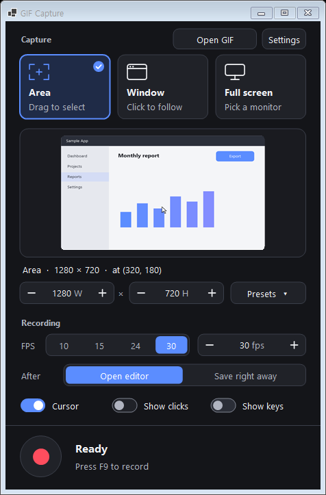

<p align="center">
  
</p>

<h1 align="center">GIF Capture</h1>

<p align="center">
  Record any part of your screen, trim it, and save a small GIF — all on your own PC.<br>
  <b>English</b> · <a href="README.ko.md">한국어</a> · <a href="README.ja.md">日本語</a>
</p>

<p align="center">
  
</p>

GIF Capture is a lightweight Windows screen recorder that turns what you record into a GIF. It is built for the everyday
cases: showing a bug to a teammate, a short how-to for documentation, or a clip of a game. Pick an area, press **F9**,
press **F9** again, and you have a GIF — or open the editor first to trim, caption and shrink it.

Nothing leaves your computer. There is no account, no upload and no cloud: recordings and GIFs are saved only on this PC.

## Download

**[⬇ Download GifCapture.exe (latest release)](https://github.com/dnwls010728/GIFCapture/releases/latest/download/GifCapture.exe)**

A single self-contained file for Windows 10 2004+ / Windows 11 (64-bit): no installer, no .NET install. Just run it.
If Windows SmartScreen warns about an unsigned app, choose **More info → Run anyway**.
All versions are on the [Releases](https://github.com/dnwls010728/GIFCapture/releases) page.

## Features

**Recording**
- Three ways to choose what to record: drag an **area**, click a **window** (the area follows the window as it moves), or pick a **whole monitor**
- A blue outline stays on screen so you can move and resize the area by dragging; a magnifier and edge snapping help you place it on the exact pixel
- Type the width and height, or use **size presets** (360p, 720p, 1080p, square, portrait…) and save your own
- 1–60 FPS, optional mouse cursor, **click highlights** and **on-screen key presses** for tutorials
- 3-second countdown, global **F9** hotkey; the app's own windows never show up in the recording

**Editing**
- Timeline with thumbnails, playback, multi-select (Shift / Ctrl / drag)
- Delete, keep selection, **trim start / end**, duplicate, reverse, ping-pong loop
- Per-frame duration and 2× faster / slower
- **Captions** for explanatory GIFs, crop, rotate 90°, flip
- Zoom and pan the preview, full undo / redo

**Export**
- One-click use-case presets: **Docs**, **Social** (≤ 1280 px wide), **Game** (high quality, 30 fps)
- Quality, image size, max FPS, merge near-identical frames, loop count (forever or N times)
- **Upscaled export**: image size up to 600%, with ×2–×6 buttons or any value on the slider. Choose how pixels are enlarged: **Sharp** (crisp blocks), **Smooth** (bicubic) or **Smart** (Scale2x/3x, smooths jagged diagonals); the preview shows the result
- **Live file size estimate** and **fit to a target size** (e.g. 15 MB) automatically
- Small files by design: only the changed part of each frame is stored
- Save straight to a folder, copy the file to the clipboard for **Ctrl+V** into chats, or export a **PNG sequence** with a timing CSV for game engines
- Open existing GIFs to edit them (button, Ctrl+O, or drag and drop)

**Interface** in English, Korean and Japanese, with a dark theme designed for readability.

## Screenshots

| Main window | Editor |
|---|---|
|  |  |

| Export settings | Settings |
|---|---|
|  |  |

## Getting started

### Requirements
- Windows 10 version 2004 or later (Windows 11 recommended), 64-bit

### Build and run
GIF Capture is a .NET 10 WinForms app with no third-party dependencies.

```powershell
git clone https://github.com/dnwls010728/GIFCapture.git
cd GIFCapture
dotnet run -c Release
```

To produce a single, self-contained `GifCapture.exe` that runs without installing .NET:

```powershell
dotnet publish -c Release -o publish
```

The app is then at `publish\GifCapture.exe`. Copy it anywhere and run it; settings are kept in `%AppData%\GifCapture`.

## How to use

### 1. Choose what to record
Click one of the three cards in the main window:

- **Area** — drag a rectangle on the frozen screen
- **Window** — hover a window and click it
- **Full screen** — click a monitor

You can also pick a size from **Presets** to place an area of that size in the middle of the screen.

### 2. Adjust the area
A blue outline appears around the area. Drag its edges or corner handles to resize and the size tab above it to move it.
While dragging, a magnifier shows the exact pixel under the edge. The inside of the outline stays clickable, so you can
keep using the app underneath. You can also type an exact width and height in the main window.

### 3. Record
Press the red button or **F9**. After a 3-second countdown the outline turns red and shows the elapsed time.
Press **F9** again to stop.

Before recording you can choose:
- **FPS** — 10 to 30 for most GIFs
- **After** — *Open editor* to review first, or *Save right away* to save with your last export settings
- **Cursor**, **Show clicks**, **Show keys** — turn *Show keys* off while typing passwords

### 4. Edit (optional)
The editor opens with every frame on the timeline. Select frames by clicking, Shift-clicking or dragging, then use the
**Edit** tab to trim, delete, change timing, add a caption, crop or rotate. Every change can be undone with **Ctrl+Z**.

### 5. Export
On the **Export** tab, pick a use-case preset or set quality, size and FPS yourself. Sizes above 100% enlarge the output
(**×2–×6** buttons), with a choice of **Sharp / Smooth / Smart** enlargement. The estimated file size updates as you
change settings; set a **Target size** and click **Fit to size** to let the app find settings that fit. Choose the file
name and click **Save GIF** (**Ctrl+S**). The file is copied to the clipboard so you can paste it straight into a chat.

## Keyboard shortcuts

| Where | Key | Action |
|---|---|---|
| Anywhere | F9 | Start / stop recording |
| Main window | Ctrl+O | Open a GIF |
| Countdown | Esc | Cancel |
| Editor | Space | Play / pause |
| Editor | ← → (Shift) | Previous / next frame (extend selection) |
| Editor | Home / End | First / last frame |
| Editor | Ctrl+A / Esc | Select all / clear selection |
| Editor | Del / Ctrl+D | Delete / duplicate frames |
| Editor | Ctrl+Z / Ctrl+Y | Undo / redo |
| Editor | Wheel, Ctrl+0, Ctrl+1 | Zoom, fit, 100% |
| Editor | Ctrl+S / Ctrl+Shift+C | Save / copy saved file |

## Privacy

GIF Capture works entirely offline. It does not upload, sync or send anything. The *Show keys* option uses a keyboard hook
only while you are recording, and only to draw the pressed keys into your own GIF.

## Project layout

| File | Purpose |
|---|---|
| `MainForm.cs` | Main window: target selection, presets, recording flow |
| `RegionSelector.cs`, `RegionFrame.cs`, `Loupe.cs` | Area / window / monitor picker, on-screen outline, magnifier |
| `Recorder.cs`, `ScreenGrabber.cs`, `InputOverlay.cs` | Capture loop, GDI screen copy, click and key overlays |
| `FrameStore.cs` | Compressed temporary frame storage |
| `EditorForm.cs`, `EditorCanvas.cs`, `Timeline.cs` | Editor window, preview, timeline |
| `GifEncoder.cs`, `GifExporter.cs` | GIF encoder (median-cut palette, LZW, changed-area frames), export pipeline, GIF loader |
| `Strings*.cs` | UI text in Korean (source), English and Japanese |

## License

[MIT](LICENSE)
